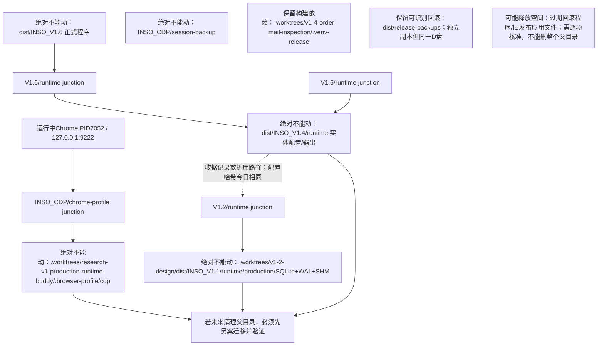

# V1.6生产资产与架构专项体检 — 2026-11-02

结论：**AUDIT_COMPLETE / NO_RUNTIME_CHANGE**。最紧迫的问题是资产依赖隐藏在旧目录名下；本轮未发现足以据此宣布当前生产业务故障的证据。所有清理和优化均为建议，未执行。

## 范围与证据

- Owner本轮指令；已读AGENTS、AI_START_HERE、CEO_HANDOVER第5/6/11节、当前V16_RELEASE_REPORT及原邮件调研Task Packet。本报告是原RFQ-016补充，不改变CEO审核结论。
- 审计基线 `23aaf84bdb42da9fa1bd526a97a168e60202f383`；与此前本地f07ed60的差异仅为文档，已正常快进，无reset。实际应用源码仍为 `325cd19052a17c05c1d2b59a4528a2a38183b8bb`。
- 原V1.6窗口独立执行；未创建其他窗口/工作树或委派。当前本地分支名codex/v1-6-direct-login-error，远端交付分支codex/v1-6-independent-scheduling；旧提交7574516f18c8ee3225b5039f2eb4aeabd0045bbc仍为HEAD祖先。
- **LIVE**：2026-11-02约09时的PowerShell Get-Item/Get-Acl、CIM进程、TCP监听元数据，Python无内容目录统计、EXE/配置哈希、既有发布收据的发布元数据。**CODE**：当前静态源码/测试。**RECORD**：既有发布报告/收据的历史验证，不冒充今日重验。
- 未连接SQLite，未执行PRAGMA、未读行数据；未读Cookie、会话备份、凭据、客户或邮件内容。容量为逐文件逻辑字节，跳过目录reparse目标；不是物理分配空间或可释放空间承诺。在线文件会变化，非全盘原子快照。

## 真实资产依赖图

以下D路径均以 `D:/Program_Leo/` 为前缀，C工作树前缀为 `C:/Users/Leo/.codex/worktrees/`。箭头为真实junction或有证据的运行引用，虚线为既有发布收据记录的配置引用。

### 现场资产与容量

| 资产（相对上述D前缀） | LIVE结果 / 逻辑容量 | 清理边界 |
|---|---|---|
| INSO_CDP/chrome-profile | junction准确指向INSO_Leo/.worktrees/research-v1-production-runtime-buddy/.browser-profile/cdp；实体1,175,849,957 B，4,879文件，约1.095 GiB | **绝对不能动**别名、实体及承载父目录；只有另案安全迁移后才能清理载体 |
| INSO_CDP/session-backup | 实体21,344 B、3文件；latest备份文件3,686 B，mtime上海11-02 09:23:22；其余两件为09-29历史文件 | **绝对不能动**；这不是完整Profile冷备，未验证可恢复性 |
| INSO_Leo/dist/INSO_V1.6 | 268,122,324 B应用文件，不含junction目标；runtime链接到V1.4/runtime | **绝对不能动**当前程序/链接 |
| INSO_Leo/dist/INSO_V1.4/runtime | 实体2,043,319 B、107文件；V1.5和V1.6共享 | **绝对不能动**，不能连同V1.4旧程序整目录删除 |
| INSO_Leo/dist/INSO_V1.2/runtime | junction到.worktrees/v1-2-design/dist/INSO_V1.1/runtime | **绝对不能动**当前配置仍引用的别名及其实体 |
| 上述v1-2实体runtime | 10,358,305 B、59文件；production/workflow.sqlite3 942,080 B，WAL当时0 B，SHM32,768 B | **绝对不能动**三件及运行数据；WAL暂为0不等于可删；未查数据库内容/一致性 |
| INSO_Leo/dist/release-backups | 4,324,945,826 B、45,883文件，约4.028 GiB；全树未发现目录reparse链接 | 保留回滚/证据，旧副本仅列候选，不批准删除 |
| INSO_Leo/dist/INSO_V1.2 / V1.3 / V1.4 / V1.5 | 分别264,743,512 / 265,161,091 / 270,023,675 / 267,915,830 B；V1.4包含上述在线runtime，V1.3也有实体runtime | 只能评估应用文件，不能删父目录或runtime |
| INSO_Leo/.tmp | 已见24,579,220 B；9项访问/变化错误，统计不完整 | NOT_VERIFIED，无可安全删除清单 |
| INSO_Leo/build、dist/INSO_V1.1/runtime | 未取得实体；目录缺失与既有历史路径不能混同 | 不以扫描失败推断有可回收空间 |

D盘当时空闲208,067,010,560 B（约193.78 GiB）；没有容量证据要求立即冒险清理生产资产。上述父子容量不可重复相加。

### 会话保护与正式程序一致性

- **LIVE** Chrome监听根进程PID7052使用canonical chrome-profile及9222；其子进程不是第二套浏览器。仅核对命令行中的Profile/端口字段，不访问/json/version或页面。Default目录和Cookie数据库存在并有当日修改元数据；**登录有效性NOT_VERIFIED**。
- canonical目录的README-DO-NOT-DELETE存在。Profile别名、实体载体、session-backup均为继承ACL；可见Authenticated Users的Modify及Users的ReadAndExecute。保护主要依赖路径治理，**不存在已验证的防误删/不可变或备份加密保证**；没有改ACL。未读取Cookie或备份内容，也未尝试恢复。
- **LIVE** 正式EXE路径 `D:/Program_Leo/INSO_Leo/dist/INSO_V1.6/INSO_V1.6.exe`，8,287,273 B；SHA256 **55be53be2c00079efcdb17addf930e30a7ce25cf233725bbd5f25500b1526bc3**，与当前发布报告及最新收据new_exe_sha256相同。
- PID422964业务GUI（11-01 14:50:28启动）、其子PID422044为原--watch-runtime观察器，同一正式路径：**一个业务实例加原观察器**。本轮没有启动/停止它们。进程存在不证明当前GUI交互、自然业务或所有网站可用。
- 当前V1.4 runtime的production.json、research.json哈希均与最新发布收据相同；没有打开配置字段。数据库实体路径由该收据给出，alias解析已核对；未做运行中句柄/SQLite连接验证，因此“当前打开的DB句柄”NOT_VERIFIED。

### 回滚独立性与可识别版本

最新三份均有program、data和release-receipt.json；分别2,986/2,986/2,987文件，**无目录reparse、无nlink>1文件**，三个EXE的NTFS文件ID也互异且不同于在线EXE。证明它们不是在线目录junction或文件hardlink；同一D盘并非异地/故障域独立备份。数据备份完整性为RECORD收据verified=true，今日未连接备份DB或执行旧程序，当前完整恢复能力NOT_VERIFIED。

| release-backups子目录 | 逻辑字节 | 备份中旧EXE SHA256 | 可识别的回滚源码 |
|---|---:|---|---|
| INSO_V1.6-brand-date-quotes-20261101T064857Z | 271,806,664 | 08a734889aaf259b01c33a2a4a1619c8de479256093fa2e6f3a0579308da0e58 | 5bb8c941d8f772ea6cfb209b077a91c678b400ea，由前一份收据new hash对应 |
| INSO_V1.6-order-association-20261101T041255Z | 271,724,636 | 7d5f6ff489d95f479c9db196ec542dd2c8f10a1972c82106ce800bb427d55512 | 4b61f521c0f1f0836be71e3cfc792c66e5e4610d，同上 |
| INSO_V1.6-rfq016-20261031T101939Z | 271,433,353 | b51c7f66e41a6c3f6266ff772e9eef8aeb161f986d2705b97320d67ce62b283b | NOT_VERIFIED，不能拿此收据的source_sha冒充旧程序源码 |

收据source_sha指**当次新装版本**，不是program中旧程序的版本。旧备份的程序集合还包括：V1.3_20261009_132642_19974a78 264,939,689 B；两份V1.5（final269,435,683 B、unified269,454,400 B）；10份其他V1.6程序回滚（reviewed/cache/retained/option-a/seven-day/task-center-sort/google-identity/google-handoff/google-read-fix/manual-busy，共10份），每份约269–270 MB。早期V1.3/RFQ006及V1.6-before小目录只有少量记录/数据，**没有根/program下EXE，不能称独立完整程序回滚**。

除最新三份外总计3,509,981,173 B（约3.269 GiB）。这是旧备份全集的容量上界，**不是全可删**：各旧EXE哈希不同，有独特版本/记录。未来先定保留周期、核对完整程序与依赖/证据，再评估淘汰；禁止恢复旧账本覆盖新业务记录。

### 关联工作树及被忽略资产

| 工作树/载体 | 容量元数据 | 结论 |
|---|---|---|
| D .worktrees/research-v1-production-runtime-buddy | 已见1,175,850,281 B，3错误，不完整 | **不在git worktree list，且.git不存在，但承载在线Profile；绝不能据此视为垃圾** |
| D .worktrees/v1-2-design | 已见1,138,450,481 B，51错误，不完整 | 注册工作树，承载在线DB；先迁移数据才能评估父目录 |
| D .worktrees/v1-4-order-mail-inspection | 已见2,626,164,733 B，11错误，不完整 | 注册工作树，.venv-release为实体且原发布使用；pyvenv.cfg历史创建命令含v1-2路径，这不是当前junction证据。勿删环境 |
| D .worktrees/hotfix-v1-1-research-stability | 已见545,941,174 B，2错误，不完整 | 旧dist/runtime仍链接v1-2实体；旧build/windows-release-stage/runtime链接v1-1-windows-release旧路径（目标本轮未核实）；不能递归跟随清理 |
| C v1-5-tp-research/INSO_Leo | 15,298,872 B，完整、未见目录reparse | 注册旧研究工作树；唯一提交/dirty状态未逐一审计，不批准删除 |
| C v15-unified-tasks/INSO_Leo | 15,620,570 B，完整、未见目录reparse | 注册detached工作树，仍应保留独特历史 |
| C v16-independent-scheduling/INSO_Leo | 19,911,148 B，完整、未见目录reparse | 当前V1.6源码工作树，保留 |
| D INSO_Leo主仓库 | 非本次全量统计 | 有既存大量未知dirty/untracked及其他资产体检文件；未添加、覆盖或清理 |

“完整”仅指当次无错误完成且跳过链接目标的逻辑统计；不完整值为已见下界，不能算可释放量。Vault、配置、订单输出、所有SQLite/WAL/SHM、Chrome会话、Git共同对象库和未知dirty均受保护；未检索凭据位置或内容。

**可能瘦身的候选**：旧回滚中超保留周期的程序副本；V1.2及V1.5旧发布应用文件合计532,659,342 B（约508 MiB，不含链接runtime）；旧工作树明确无引用的构建/测试暂存。均需再做逐项引用/独特历史/保留策略核对，目前**可立即批准删除量为0**。本轮不替另一个非业务资产任务执行清理。

## 架构调用关系与隐患

主路径：进程入口 → ProductionBackend.start_process_services / start → _run → _run_independent_poll → WorkflowRuntime.claim_due_module → _run_independent_job → 原询价/报价/TP组合层。浏览器和业务写入由既有owner线程串行，原通知worker独立发送。通知：Backend内容/事件/现态审核 → V12NotificationWorker.run_due → V12Store原子收件人claim → 原SMTP → 结果入账；网络调用不包在该SQLite写事务内。后台只读仍共享原Chrome/CDP，拥有独立目标页和线程客户端。

计量供定位而非定罪：backend.py3,710行，ProductionBackend本身118个直接方法（全文件含其他类/嵌套函数157个）；v12_store.py1,801行。未采用旧文档的约137方法数作精确事实。

| 隐患 / 等级 | CODE依据与现有保护 | 生产是否发生 / 改善收益 |
|---|---|---|
| 编排责任集中，通知规则修改牵动来源、状态和浏览器 / P1维护风险 | backend.py:656 start_process_services、1258 _run_independent_poll、1755 _execute_order_action_impl、2892 _current_mail_source、2944 _notify_runtime_fault、2992 _review_current_mail、3072 _catalog_source、3575 _cache_workbench；状态分散于source projection/store/GUI缓存；已有notification_review、v12_faults、automatic_admission纯规则可复用 | RECORD有历史误报/状态及关联问题，**未证明由文件集中直接造成**。先提取通知组合边界可缩小改动面，保留目前状态/年龄/UNKNOWN保护 |
| Chrome共享资源、多个客户端/页租约的异常清理复杂 / P1 | browser_bootstrap.py:91 disconnect只在owner线程stop，外线程入deferred队列，102 drain；127 close仅owned执行close_fn；387 acquire持久Profile不会被纳入关闭所有权。Backend:2013保护keepalive、2035关闭订单页、2196释放idle；google_web.py:172隔离读用独立锁/页角色；mail_session.py:42 operation_page、62 read_source专属页/三次有限恢复 | RECORD有Google读取/页身份故障；**没有本轮线程互锁/误关页证据，根因不能一概归并**。若owner线程未再drain，deferred客户端可能滞留，属于静态异常路径风险；统一已有资源状态摘要可减少排障盲区 |
| 正常退出没有统一总等待上限 / P1 | backend.py:3518 shutdown先释放_lock再join，3529/3531/3533/3538无join timeout；656启动也等待一次性local loader。workflow/mail_research.py:444 close等原线程完成。market_actors.py:405 close虽10秒有界，超时只返回False，不会杀线程；不能当实际释放成功 | **未证实当前生产卡死**。有正常退出历史；本轮不触发退出。若底层永久不返回，总退出时限无法仅由单个网络timeout证明；未来需可观测draining/owner确认，不能简单join超时后宣布安全并覆盖程序 |
| 统一SQLite写竞争及恢复契约容易被未来修改破坏 / P1 | v12_store.py:1692 _transaction采用BEGIN IMMEDIATE、回滚/关闭；1729连接timeout30秒，claim_due_notifications:604按recipient且business/mail scope分离；record_notification_result:786只接受sending；892恢复inflight为UNKNOWN。service.py:666未知业务终态保留lease/latch，864/888模块单owner。现有事务短且不覆盖SMTP，未发现需拆库依据 | **本轮未连接DB，当前锁等待/损坏/重复写NOT_VERIFIED**。SMTP已接收但结果未入账的崩溃窗口真实存在于外部事务边界，由UNKNOWN阻止重发；不能声称端到端exactly-once。统一状态/恢复契约与故障注入测试能防误改，不应重构数据表 |
| 独立调度不等于所有执行并发；慢主业务仍会推迟其他到期模块 / P2 | service.py:888 claim_due_module仅一个_module_resource，906下次到期按完成时间+原周期；backend.py:1318 _yield_quotation_to_tp仅已确认安全边界借用。research_budget.py:18 foreground从不获取background gate，32 background在checkpoint让位，当前不会因后台先锁而等待整个后台读取 | 当前代码及既有线程测试已修复“后台先取锁阻塞主业务”；不能重复列作未修缺陷。共享Chrome/CPU/网络仍非物理隔离。本轮未计量当前排队延迟；收益先由既有轮次记录和健康摘要验证 |
| 网站读取契约集中且对网页变化敏感 / P2 | duplicate_history.py:348 read为真实操作页入口，397响应解析、488行身份、521详情回读，590响应请求及950稳定性检查；MPN/记录身份/数量日期验证不可省略；被原重复采购保护调用 | 历史网站读取错误见RECORD，但当前页面契约未现场复验。收益是未来按“解析/浏览器settlement”分小边界并保留相同输入输出；没有足够收益支持本轮动此模块 |

没有在静态阅读中发现可证明的必然循环等待；这不等于对所有异常线程时序的证明。RFQ-016详细报告120秒降级已有mail_research_composition.py:123/143，当前先保持，不以新增协调器重写它。

### 可复用能力、可选框架及真正闲置代码

- ResearchBudget已实现不等待后台锁的前台准入，WorkflowRuntime已有模块/订单/市场租约与UNKNOWN latch，PageResourceAdmission及BrowserHandle已有owner/页保护，V12队列已有最终审核/幂等。应复用，不能再造调度器、SMTP或数据库。
- get_diagnostics（backend.py:3481）当前主要给run/uptime/thread/last_poll，observation和模块日志已有开始/完成/耗时信息；可复用但未汇总成资产/资源健康证据。不另建监控进程。
- MarketReadActors（market_actors.py:153/265）最多2个固定worker、每个单槽队列、owner检查及terminal回收；Backend:541默认factory=None，src调用检索未见正式入口注入。属于**默认未启用、有测试的可选代码，不是可以直接删的死代码**。未来只有连续自然轮次常接近/超过原900秒或TP明显受挤占，且确认瓶颈在可并发市场读取时才值得另案试点；目前没有本轮实测收益，不建议启用。
- **纠正一个文档陷阱**：src/quotation/README称未来目录，但update_result.py的parse_update_popup由workflow/v13_quote_update.py:9真实引用，是当前报价成功/已有/未知语义保护，绝非闲置。FakeNotificationTransport仅测试使用亦是必要测试能力。
- 本轮未证明有值得删除的生产死代码；旧阶段CLI/可选框架无默认调用不等于无历史/手工用途。避免凭文件大小或目录旧名清理。

## 仅推荐三项未来优化（均未实施）

1. **资产防误删检查，优先级最高**：复用现有发布资产/路径检查，在未来清理入口先解析junction与真实路径，列出Profile、DB、runtime、Vault、构建环境、回滚依赖；只要目标覆盖保护实体或引用未知即拒绝清理。先dry-run清单，后增加独立路径测试，不移动任何资产。收益：直接防止不可恢复的登录/账本误删。回退：仅撤回检查代码，资产始终不变。测试复用tests/launcher/test_countdown_browser_release.py与现有发布路径/保护测试；补充junction载体不在Git注册表、父目录包含在线runtime、reparse不跟随、路径别名等离线用例。真正迁移Profile/DB必须另案授权及冷备验证，本提案不包含迁移。
2. **第一处Backend拆分选通知组合层**：先保持_prepare_business_mail、_current_mail_source、_review_current_mail、_notify_runtime_fault原入口，提取纯审核输入/输出适配，一次只迁一小组；继续调用原notification_review/automatic_admission/prepare_business_report，保留原V12Store、SMTP、120秒和发送顺序，不新建队列/表/调度。下一阶段再搬事件观察；暂不动Browser Owner/调度。收益：RFQ-016最敏感通知修改的影响面缩小。回退：单提交撤回，既有数据无需迁移。必跑test_business_mail_fallback.py、test_v12_notifications.py、test_rfq016_regressions.py、test_rfq016_review.py及完整离线套件；新提取用同输入比对原结果，不缩减旧断言。
3. **复用健康快照描述资源/收口状态**：在get_diagnostics复用observation/既有模块日志，先只增加模块耗时、到期等待、deferred stop数量、退出draining/未收口owner，不读私密数据、不轮询页面、不改调度或强制释放；无需新线程。以实测决定是否另做安全退出改进，不能用超时返回替代真实关闭。收益：分清“到期等待/站点慢/资源保护/正常停机”，为将来是否值得双Actor提供依据。回退：撤回只读字段。测试复用test_order_mail.py、test_market_actors.py、test_tp_safe_quotation_yield.py、test_order_resource_leases.py和test_rfq016_second_review.py中的后台先执行真实线程用例；若以后改退出另补永久卡住/owner消失/不误关Chrome的离线时序测试。

## 验证、限制与本次未执行

- 本次只修改原任务文档；静态AST解析七个重点文件、路径/引用核对、发布哈希/收据对应、Git祖先与diff检查。**没有运行业务源码测试或完整回归**；已发布源码的3450 PASS/1系统symlink SKIP仅为既有发布证据，不是本次新增测试结果。
- src树应保持1e1e11776165fe0f920dd9fc4af8d0330fb8fc3f，tests树保持f87eb9dbfab149ce25adc995bf397c6cc65ae860；本次文档提交不改变正式EXE。
- NOT_VERIFIED：当前登录有效性、完整会话恢复、备份DB今日完整性、实时业务模块/GUI可用性与最近自然轮次、当前DB句柄和事务竞争、全部旧工作树dirty/独特提交、全量hardlink跨历史版本关系、被拒绝目录容量、旧stage目标有效性。
- 未做GitHub公开性审查、IMAP专项验收/策略复议；未读取业务/邮箱内容或凭据；未执行订单、采购、报价、Google写入、测试发信；未CDP连接、登录、关页、改ACL、迁移、删文件、清worktree、改源码/表/调度、启双Actor、打包部署、重启/停止生产。
- **COMPUTER_USE_NOT_USED**。使用PowerShell/Python/Git只读元数据和静态源码工具；无长期值守或后台诊断程序遗留。生产保留原运行状态，当前业务验收不在本轮范围。
